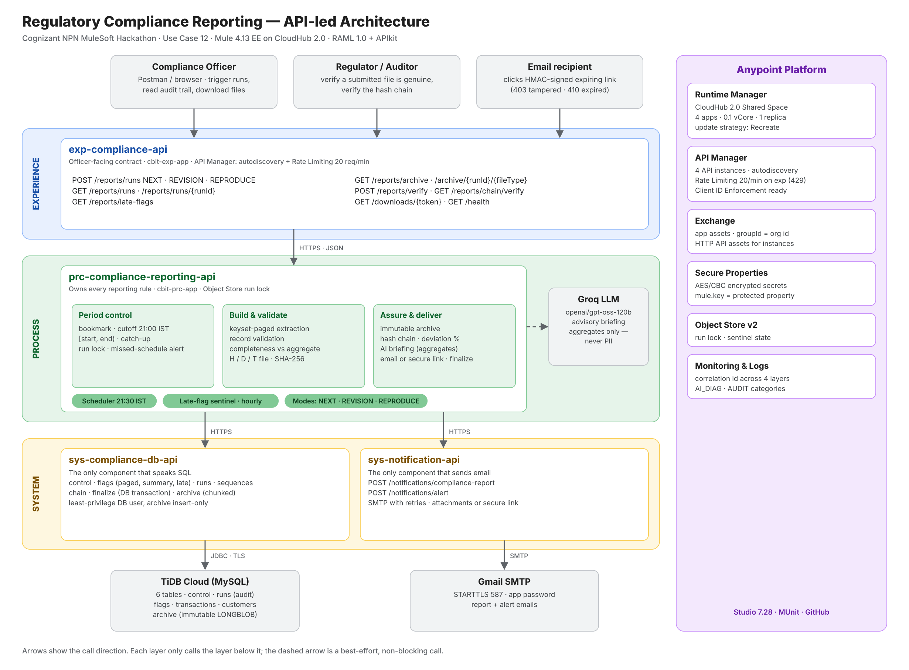

# Regulatory Compliance Reporting – MuleSoft

Cognizant NPN MuleSoft Hackathon 2027 · **Use Case 12: Compliance – Regulatory Compliance Reporting**

Every night at 21:30 IST the integration reports all flagged (suspicious) transactions of the
business day to the compliance officer: it extracts them from the database, builds the
prescribed H/D/T submission file plus a readable summary, archives both immutably and emails them,
with full audit, no gaps, no overlaps and byte-identical regeneration.

## Architecture (API-led)



Detailed view: [docs/architecture/detailed-architecture.png](docs/architecture/detailed-architecture.png)

```
 Officer / Postman / AI agent (MCP)
              │
   ┌──────────▼───────────┐
   │  exp-compliance-api  │  Experience: re-run, runs, verify, secure download, hash-chain check
   └──────────┬───────────┘
   ┌──────────▼────────────────────┐  ◄── Scheduler 21:30 IST
   │ prc-compliance-reporting-api  │  Process: period control, paged extraction, completeness,
   └──────┬─────────────────┬──────┘           validation, H/D/T report, checksums, archive, alerts
   ┌──────▼──────────┐ ┌────▼─────────────────┐
   │ sys-compliance- │ │ sys-notification-api │  System: all SQL / all email
   │ db-api          │ └────┬─────────────────┘
   └──────┬──────────┘      │
        TiDB (MySQL)     Gmail SMTP
```

**Full design:** [docs/HLD.md](docs/HLD.md)

## Live on CloudHub 2.0

| App | Public endpoint |
|---|---|
| exp-compliance-api (officer API) | `https://cbit-exp-app-z0s4lp.5sc6y6-1.usa-e2.cloudhub.io/api` |
| prc-compliance-reporting-api | `https://cbit-prc-app-z0s4lp.5sc6y6-2.usa-e2.cloudhub.io/api` |
| sys-compliance-db-api | `https://cbit-sysdb-app-z0s4lp.5sc6y6-3.usa-e2.cloudhub.io/api` |
| sys-notification-api | `https://cbit-notify-app-z0s4lp.5sc6y6-3.usa-e2.cloudhub.io/api` |

### Try it

```bash
EXP=https://cbit-exp-app-z0s4lp.5sc6y6-1.usa-e2.cloudhub.io/api

curl $EXP/health                                   # all four layers UP
curl "$EXP/reports/runs?status=SUCCESS"            # audit trail of issued reports
curl $EXP/reports/chain/verify                     # tamper-evident hash chain: valid true

# regenerate an issued report and prove it is byte-identical
curl -X POST $EXP/reports/runs -H "Content-Type: application/json" \
  -d '{"mode":"REPRODUCE","originalRunId":"RUN-20261111-145311-52b680","requestedBy":"judge"}'

# download the archived file (X-Content-SHA256 header = stored checksum)
curl -OJ $EXP/reports/archive/RUN-20261111-145311-52b680/SUBMISSION
```

The experience API is rate-limited to 20 requests per minute (API Manager policy).

## Features

* Nightly STR in the prescribed H/D/T format, 21:30 IST, with **catch-up** of any missed day
* Completeness check against an independent aggregate · NIL reports · revisions (seq 002…)
* **Byte-identical regeneration** (REPRODUCE) · SHA-256 file and detail checksums
* Immutable archive (insert-only DB grants) · full audit row per run · correlation id across all layers
* Volume deviation alert · attachment-size limit with **HMAC-signed expiring download link** (403 / 410)
* Extras: **hash chain** across all reports, **AI compliance briefing** (aggregates only), late-flag sentinel,
  verification API, API Manager governance

## Repository layout

| Folder | Contents |
|---|---|
| `db/` | Schema, seed data, least-privilege user, negative-scenario scripts |
| `sys-compliance-db-api/` | System API – database |
| `sys-notification-api/` | System API – email |
| `prc-compliance-reporting-api/` | Process API – nightly orchestration |
| `exp-compliance-api/` | Experience API – officer-facing endpoints |
| `docs/` | [High Level Design](docs/HLD.md) – architecture, flows, requirement mapping, test evidence |

## Local ports (Studio)

| App | Port |
|---|---|
| exp-compliance-api | 8081 |
| prc-compliance-reporting-api | 8082 |
| sys-compliance-db-api | 8083 |
| sys-notification-api | 8084 |

On CloudHub every app listens on `8081` (the platform default) and is reached through its own URL.

## Secrets

Real credentials live only in each app's `config-secure-<env>.yaml`, encrypted with the
Mule Secure Properties tool. The encryption key is passed at runtime (`-Dmule.key=...` locally,
a protected property on CloudHub) and is never committed.
