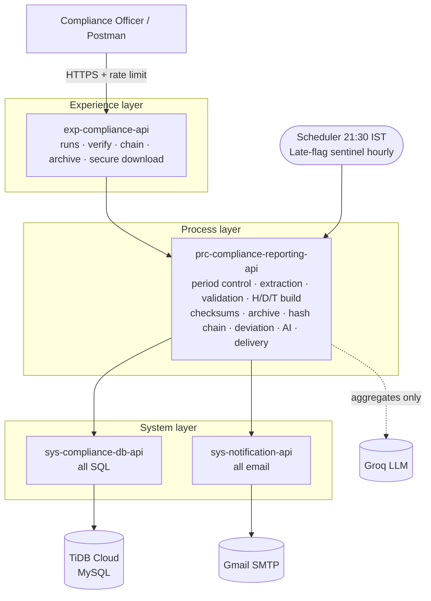
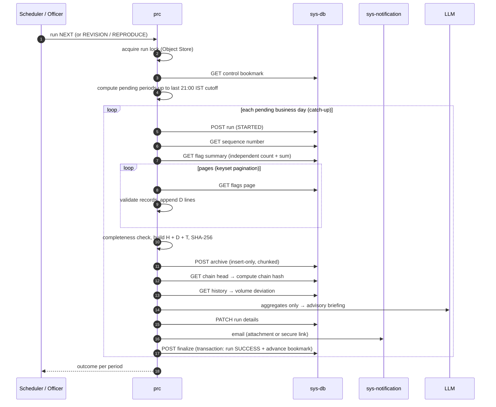
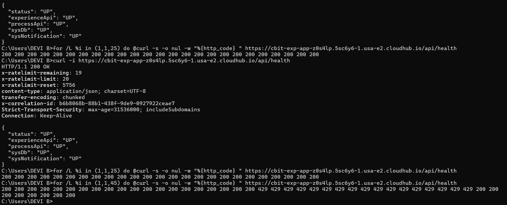
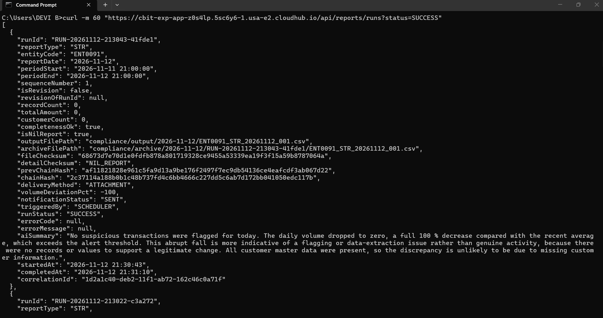
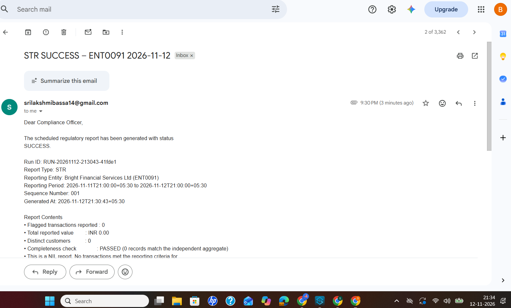
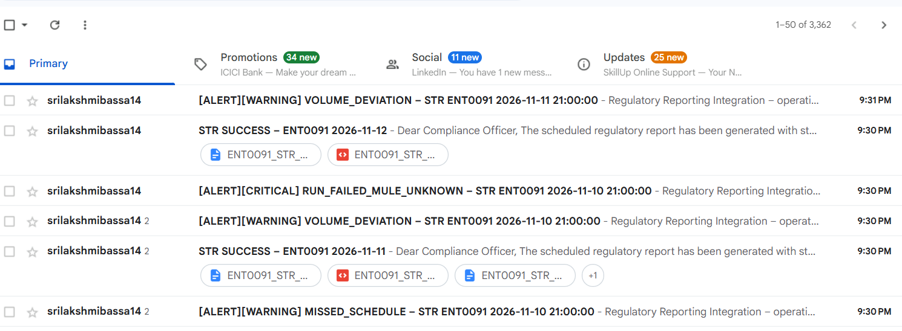
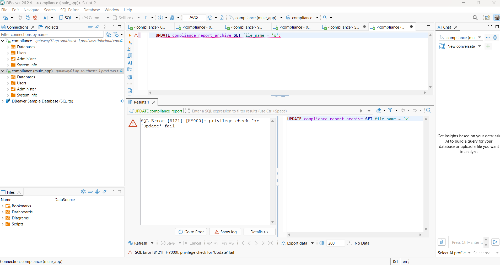
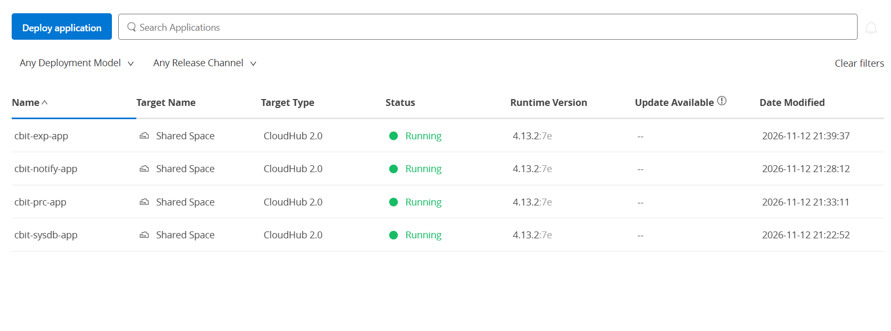

# High Level Design – Regulatory Compliance Reporting

**Cognizant NPN MuleSoft Hackathon · Use Case 12 · Compliance – Regulatory Compliance Reporting**
Platform: Mule 4.13 EE on CloudHub 2.0 (Sandbox) · Database: TiDB Cloud (MySQL-compatible) · Email: Gmail SMTP · AI: Groq `openai/gpt-oss-120b`

---

## 1. Problem in one paragraph

A bank's risk analysts flag suspicious transactions during the day. Every business day the bank must send the
regulator a **Suspicious Transaction Report (STR)** in a fixed pipe-delimited **Header / Detail / Trailer** format,
plus a readable summary for the Compliance Officer. The report must be **complete** (every flag of the day, nothing
twice, no day missed), **provable** (checksums, immutable archive, audit trail), **reproducible byte-for-byte**, and it
must still be produced on days with no suspicious activity (**NIL report**). Late flags lead to a **revision**
(sequence 002, 003 …). Failures must never silently lose a day.

## 2. Solution at a glance

| Capability | How it is delivered |
|---|---|
| Nightly STR file in the prescribed H/D/T format | `prc` builds it with DataWeave from paged DB extraction (`dwl/report.dwl`) |
| No gaps / no overlaps | Control table bookmark, half-open period `[start, end)`, business-day cutoff 21:00 IST, catch-up of every pending day |
| Completeness check | Independent aggregate (count + sum) compared with the extracted records before the file is issued |
| Byte-identical regeneration | `REPRODUCE` mode rebuilds from the same data and compares SHA-256 with the archived file |
| Immutable archive | DB archive table is insert-only (no UPDATE/DELETE grant) + per-run folder written with `CREATE_NEW` |
| Checksums | SHA-256 of the file and of the detail section (trailer carries the detail checksum) |
| NIL report | Zero-record days still issue H + T with `NIL_REPORT` marker |
| Revision | `REVISION` mode: same period, next sequence number, linked to the original run |
| Volume deviation alert | % change versus the trailing average of non-revision reports; alert above threshold |
| Large file → secure link | Above the attachment limit the email carries an expiring HMAC-signed download link instead of the file |
| Failure safety | Control bookmark advances only inside the finalize transaction; any failure leaves the day pending and alerts |
| Audit | Every run row records who/when/what, checksums, chain hash, delivery, deviation, AI briefing, correlation id |

**Extras beyond the brief:** tamper-evident **hash chain** across all issued reports, **AI compliance briefing**
(aggregates only, never PII), **late-flag sentinel**, **verification API** (prove a file is genuine), **secure
expiring download links**, **missed-schedule catch-up alert**, **API Manager governance** (autodiscovery, rate limiting).

---

## 3. Architecture (API-led connectivity)



| Layer | App | Responsibility | Why separate |
|---|---|---|---|
| Experience | `exp-compliance-api` | Officer-facing contract, secure download links, audit of officer actions | Can be governed (policies) and changed without touching the engine |
| Process | `prc-compliance-reporting-api` | All business rules of reporting; nightly scheduler | Single owner of the reporting logic |
| System | `sys-compliance-db-api` | The only component that talks SQL; least-privilege DB user | DB can change without touching business logic |
| System | `sys-notification-api` | The only component that sends email; retries | Channel can change (SMTP → other) without touching business logic |

All four APIs are designed contract-first in **RAML 1.0** and routed with **APIkit**.

### Deployed endpoints (CloudHub 2.0, Sandbox, US-East-2)

| App | Public endpoint |
|---|---|
| exp-compliance-api | `https://cbit-exp-app-z0s4lp.5sc6y6-1.usa-e2.cloudhub.io/api` |
| prc-compliance-reporting-api | `https://cbit-prc-app-z0s4lp.5sc6y6-2.usa-e2.cloudhub.io/api` |
| sys-compliance-db-api | `https://cbit-sysdb-app-z0s4lp.5sc6y6-3.usa-e2.cloudhub.io/api` |
| sys-notification-api | `https://cbit-notify-app-z0s4lp.5sc6y6-3.usa-e2.cloudhub.io/api` |

---

## 4. Nightly run – end-to-end flow



**Failure path:** any error in a period → run marked `FAILED` with error code/message, alert email to the Compliance
Officer, unissued output files discarded, **bookmark not advanced** → the same day is retried on the next trigger.

---

## 5. Period control – no gaps, no overlaps

* A business day ends at **21:00 IST**. Report date *D* covers `[D-1 21:00, D 21:00)` – start inclusive, end exclusive,
  so a flag at exactly 21:00:00 belongs to exactly one day.
* `compliance_report_control` holds the bookmark (`last_period_end`) per report type and entity.
* Every trigger computes **all** cutoffs between the bookmark and now and issues them in order (**catch-up**).
  Proven live: the CloudHub scheduler fired at 21:30 on 12 Nov and issued both 11 Nov (missed earlier) and 12 Nov.
* The bookmark advances **only** in the finalize DB transaction, with an optimistic check that it still equals the
  period start – two concurrent runs can never both advance it.
* An Object Store **run lock** serialises the scheduler and manual triggers.

## 6. Report file format

```
H|ENT0091|Bright Financial Services Ltd|STR|2026-11-05|2026-11-11T14:53:11+05:30|001|INR
D|1|TXN-99120455|2026-11-05T14:22:07+05:30|00214578|CUST-77219|Meena Raghavan|INDIVIDUAL|CARD_PAYMENT|ONLINE|INR|248500.00|...|CONFIRMED
...
T|3|2378500.00|3|2026-11-11T14:53:11+05:30|c10b8193bb5068edd466fa8c1e64fcee8e98e1203818b417dfec69cbac4651b2
```

* **H** entity, report type, business date, generation time, sequence, currency
* **D** serial, transaction, account, customer, channel, amount, counterparty, flag code/reason, analyst, status
* **T** record count, total amount, distinct customers, generation time, **SHA-256 of the detail section**
* File name `<ENTITY>_STR_<yyyyMMdd>_<seq>.csv`; revisions get `_002`, `_003` …
* A transaction flagged twice appears once per flag (one detail line per flag), as the brief requires.

## 7. Data model (TiDB)

| Table | Purpose | Key points |
|---|---|---|
| `customers` | Customer master | Missing customer → warning, not failure |
| `transactions` | Transactions | |
| `transaction_flags` | Analyst flags | Unique (transaction, flag code); index on (status, flagged_at) for paging |
| `compliance_report_control` | Bookmark per report type/entity | Advanced only by finalize |
| `compliance_report_runs` | One row per run – the audit trail | Status, counts, checksums, chain hashes, revision link, delivery, deviation, AI briefing, error, correlation id |
| `compliance_report_archive` | Immutable copies of every issued file | `LONGBLOB` chunks; app user has **SELECT, INSERT only** |

## 8. Integrity and security

| Control | Implementation |
|---|---|
| File checksum | SHA-256 of the full file, stored with the run and sent as `X-Content-SHA256` on download |
| Detail checksum | SHA-256 of the D lines, written into the trailer |
| Immutable archive | DB grants forbid UPDATE/DELETE on the archive (verified: TiDB rejects `UPDATE` with "privilege check fail"); duplicate writes rejected and logged |
| Hash chain | `chainHash = SHA-256(prevChainHash : fileChecksum)`, starting from `GENESIS`; `/chain/verify` re-hashes every archived file and walks the chain |
| File verification | `POST /reports/verify` – any file the regulator holds can be proven genuine by checksum |
| Secure download links | `runId.fileType.expiry.HMAC-SHA256`; tampered → **403**, expired → **410**; signature checked before parsing |
| Secrets | Mule Secure Properties (AES/CBC); key passed only as a CloudHub **protected property** / `-Dmule.key` locally |
| Least privilege | Dedicated `mule_app` DB user with only the grants each table needs |
| PII in AI | Only aggregates are sent to the LLM – never names, accounts or transaction ids |
| API governance | API Manager autodiscovery; **Rate Limiting 20 req/min** on the experience API (verified: 20 × 200 then 429) |

## 9. Error handling

* Each app has a global error handler mapping errors to consistent JSON `{errorCode, message, correlationId}`
  and HTTP status (400, 403, 404, 409, 410, 502, 503, 500).
* Outbound calls use `until-successful` retries with configurable delay.
* The AI briefing is best-effort: if the model is unavailable the report is still issued, the reason is logged
  (`AI_DIAG`), and the briefing is simply omitted.
* Correlation id is propagated across all four layers and stored with the run, so one id traces a run end to end.

## 10. Test evidence

| Scenario | Result |
|---|---|
| Normal day (5 Nov, PDF sample) | 3 records, ₹2,378,500.00, trailer checksum matches |
| Catch-up of several days | 6–10 Nov issued in one trigger, in order |
| NIL day | 6, 10, 11, 12 Nov issued as NIL reports |
| Boundary + double flag (7 Nov) | 5 detail lines, 4 customers |
| High volume (8 Nov) | 12 records, deviation +350 % flagged |
| Revision | 7, 9, 10 Nov re-issued as seq 002, linked to the original run |
| Reproduce | Regenerated 5 Nov file byte-identical (`e999e20b…`) – locally and on CloudHub |
| Hash chain | `valid: true` over 9 links, all archives intact |
| Scheduler on CloudHub | Fired 21:30 IST, `triggeredBy: SCHEDULER`, caught up 11 and 12 Nov |
| Tampered / fake download link | 403 `INVALID_LINK` |
| Archive overwrite attempt | Rejected by DB grants |
| AI model retired upstream | Detected via `AI_DIAG` (404), switched model; reports never blocked |
| Rate limiting | 20 × 200, then 429 Too Many Requests |
| Failure handling | Failed runs recorded with error code/message; bookmark not advanced; next trigger retried |

MUnit suites (DB, File, SMTP and HTTP mocked) exist for all four applications.

### Screenshots

| Evidence | |
|---|---|
| Rate limiting – 20 × 200 then 429 |  |
| Nightly scheduler on CloudHub (`triggeredBy: SCHEDULER`, AI briefing) |  |
| Report email to the Compliance Officer |  |
| Alerts – missed schedule, volume deviation, run failure |  |
| Immutable archive – UPDATE rejected by DB grants |  |
| Four apps running on CloudHub 2.0 (Mule 4.13.2) |  |

## 11. Deployment

* Four Mule deployable archives, `groupId` = organisation id, deployed to **CloudHub 2.0 Shared Space**,
  0.1 vCore, 1 replica, update strategy *Recreate*.
* Environment chosen by `env=dev`; all environment-specific values (hosts, API ids) are Runtime Manager properties,
  so the same jar promotes between environments without rebuilding.
* Each app is registered in **API Manager** through autodiscovery (`api.id` + environment client credentials).

## 12. Known limitations and next steps

* Client ID Enforcement on `/api/reports/*` is prepared but optional for the demo; download links stay public
  because they carry their own HMAC signature and expiry.
* CloudHub file storage is ephemeral – the DB archive is the durable record by design.
* Next steps: digital signature (PKI) of the submission file, MCP server so an AI agent can query run status,
  operations dashboard over the runs table.
